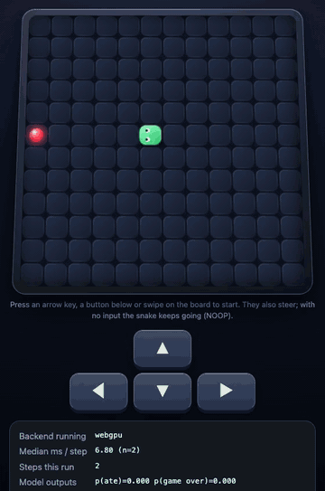

# Neural Snake

A Snake game in your browser where no game rules run. A 78,177-parameter neural network, trained from scratch on this one game, predicts every next frame from the current frame and your key press.

By **[Dev Suthar](https://github.com/devsutharsystems)** and the **[LDS Team](https://github.com/lets-data-science)**. Published by Let's Data Science. Dev created the game, the model, its training runs and its evaluation; the LDS Team turned it into a build-along with three exercises, commands for each stage and tests. See `CONTRIBUTORS.md` and `NOTICE`.



**Build it step by step:** the free guide on [Let's Data Science](https://letsdatascience.com/projects/neural-snake) walks through each piece, with checks you can run, hints and screen recordings.

Everything runs on your own computer. There is no API key, account or paid service.

## Get the project

- [Version 1.0.0 downloads](https://github.com/lets-data-science/neural-snake/releases/tag/v1.0.0): choose the **starter** to build the three exercises yourself or the **reference** to start from the finished project. The release includes SHA-256 checksums.
- This repository contains the **completed reference**. Clone it with the commands below, then follow the setup instructions. Keep your starter in a separate folder.

```bash
git clone https://github.com/lets-data-science/neural-snake.git
cd neural-snake
```

## What you need

- Python 3.12
- Node.js 22 or newer (npm installs the browser runtime, onnxruntime-web 1.31.1)
- A recent Chrome or Edge. WebGPU is used when it is available and passes the self-test; otherwise the page uses WASM.
- About 1.5 GB of free disk space for the Python packages and the generated data
- No GPU is needed. Training uses an NVIDIA GPU (CUDA) or an Apple GPU (MPS) when it finds one, and the CPU otherwise.

## Set up

Open a terminal in this folder, where `README.md` and `requirements.txt` are.

macOS or Linux:

```bash
python3.12 -m venv .venv
source .venv/bin/activate
python -m pip install -r requirements.txt
npm ci
npm run setup
```

Windows PowerShell:

```powershell
py -3.12 -m venv .venv
.\.venv\Scripts\python.exe -m pip install -r requirements.txt
npm ci
npm run setup
```

On Windows, write `.\.venv\Scripts\python.exe` wherever this guide writes `python`.

`npm run setup` copies the six onnxruntime-web files the pages load into `web/vendor/` and checks each one against the SHA-256 listed in `web/vendor/README.md`.

## Play the shipped model

```bash
python -m http.server 8000 --bind 127.0.0.1 --directory web
```

Open http://127.0.0.1:8000/ and press an arrow key to start. The page shows which backend is running, the median time per model step and the model's last probabilities. `compare.html` runs a hand-written engine beside the model on the same moves and marks every cell where they differ. It is a comparison page only; the game page never loads the engine.

Stop the server with Ctrl+C.

## Build it yourself

The three files in `learner/` are your exercises. In the starter download each function raises `NotImplementedError`; in the reference download they are complete. The completed versions are also in `checkpoints/`.

| Exercise | File | Test |
| --- | --- | --- |
| 1. Encode the board as the 14 classes the model reads and writes | `learner/encode.py` | `python -m pytest tests/test_learner_encode.py -q` |
| 2. Stop the food head from damaging the shared layers | `learner/food.py` | `python -m pytest tests/test_learner_food.py -q` |
| 3. Measure long games with censoring and Kaplan-Meier | `learner/survival.py` | `python -m pytest tests/test_learner_survival.py -q` |

The training code, the data generator and the evaluation all call your functions, so each exercise is a working part of the pipeline, not a side quiz.

If you are stuck, restore one completed exercise. Your version is saved in `.backups/` first:

```bash
python scripts/restore.py encode
```

Use `food` or `survival` for the other two.

Run every test with:

```bash
python -m pytest -q
npm test
```

In a fresh download pytest skips five tests: three need the data from `make_data.py` and two need a trained model in `models/run2_best.pt`. In the starter, the tests for your three exercises fail until you complete them.

## Make the data, train and play your own model

```bash
python scripts/make_data.py
python scripts/train.py --minutes 30
python scripts/export_onnx.py
python scripts/eval_heldout.py dryrun --model runs/my-snake.onnx
python scripts/use_model.py runs/my-snake.onnx
```

1. `make_data.py` plays the engine with scripted players and writes `data/spike_a` (50,850 steps) and `data/run1` (669,784 steps). The episode seed decides each game's split before any data exists: seed % 5 == 0 is held out, seed % 5 == 1 is validation and the rest is training. The same seeds give the same data every time.
2. `train.py` trains Dev's Run 2 model. It checks the model on 5,000 validation rows every 2.5 minutes, keeps the best checkpoint in `models/run2_best.pt` and stops early after 10 minutes without improvement. It then writes `runs/results_run2.json` and `.md`. Use `--minutes 10` for a shorter run.
3. `export_onnx.py` writes `runs/my-snake.onnx`, a single file the browser can load, and `runs/my-snake.json` with what was exported.
4. `eval_heldout.py dryrun` measures any exported model on validation rows only and writes its reports to `runs/`.
5. `use_model.py` puts your model into `web/model/`, regenerates the self-test cases for it and saves the files it replaces in `.backups/`. Reload the page to play your model. `python scripts/use_model.py --shipped` puts the shipped model back.

How long training takes: on an Apple M5 Max GPU the model reached 99.96% on the 5,000 selection rows after 2.5 minutes, and on Dev's Apple M2 it reached 100% after 15 minutes. The first line `train.py` prints names the device. On a CPU, training is about 25 times slower than on that M5 Max GPU, so use `--minutes 30`; a 30-minute CPU run there got 99.93% of the validation steps right, against 99.98% for Dev's GPU run.

## The held-out evaluation was run once

`eval/results_heldout.json` is Dev's evaluation of the shipped model on games no model or script had seen. It was run once, and `eval/heldout.lock` makes the script refuse a second run. That is deliberate: once you look at a test set and change something, it stops being a test set. Measure your own models with `dryrun` on validation rows.

The measured results, the training history and the reasoning behind each decision are in `docs/RESULTS.md`.

## Folder map

- `engine/`: the hand-written Snake engine. It generates training data and is the reference the model is compared with. The game page never uses it.
- `training/`: Dev's data generators, model and training runs.
- `learner/`: your three exercises. `checkpoints/`: their completed versions.
- `scripts/`: the commands above, plus the export, parity, self-test and web audit tools.
- `web/`: the browser pages and the shipped model in `web/model/`.
- `eval/`: Dev's validation and held-out results for the shipped model.
- `evidence/development/`: Dev's logs and results from every earlier run. `evidence/shipped-model/`: a copy of the shipped model for `use_model.py --shipped`.
- `tests/`: Python and JavaScript tests.

## Credits and licence

By Dev Suthar and the LDS Team. See `CONTRIBUTORS.md` for who made what and `NOTICE` for the details of this edition.

Apache License 2.0; see `LICENSE` and `LICENSING.md`. Dev first released Neural Snake under the MIT License, and its notice is kept in `NOTICE`. Keep `LICENSE`, `NOTICE` and `LICENSING.md` when you redistribute the project. onnxruntime-web is Microsoft's, MIT licensed; its notices are in `web/vendor/`.
